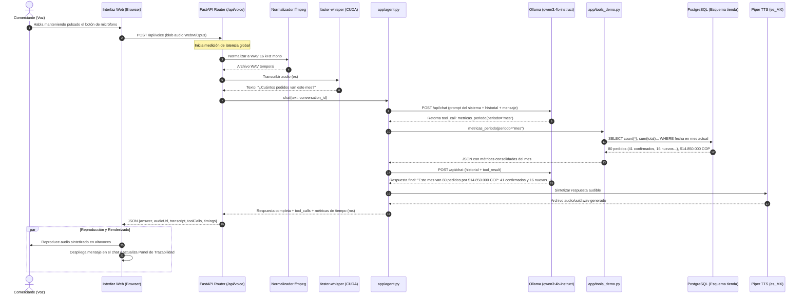
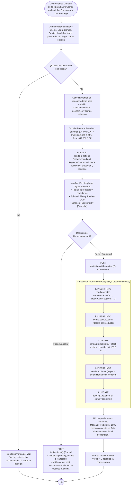

# Diagramas Técnicos y de Arquitectura: Agente de Raíz Viva Naturales

**Proyecto:** Agente de operación por voz para tiendas en línea (Raíz Viva Naturales).  
**Caso Práctico:** Tienda ficticia de productos naturales **"Raíz Viva Naturales"** con pago contra entrega en Colombia.  
**Contexto Académico:** UniPutumayo – Agentes de IA (2026). Agente propuesto por el estudiante (Comercio electrónico / MiPymes).  
**Fecha:** 2026-11-04.

---

## Índice de Diagramas
1. [Arquitectura General de Componentes](#1-arquitectura-general-de-componentes)
2. [Diagrama de Secuencia: Consulta por Voz con Herramienta Transaccional](#2-diagrama-de-secuencia-consulta-por-voz-con-herramienta-transaccional)
3. [Modelo de Datos Entidad-Relación (Esquema Tienda y Base del Agente)](#3-modelo-de-datos-entidad-relación)
4. [Diagrama de Flujo: Creación y Confirmación de Pedido (Human-in-the-Loop)](#4-diagrama-de-flujo-creación-y-confirmación-de-pedido-human-in-the-loop)

---

## 1. Arquitectura General de Componentes

Este diagrama ilustra la topología integral de la solución desplegada 100% en infraestructura local (GPU NVIDIA RTX 4050 6 GB en Windows). Se aprecia la articulación entre la interfaz web responsiva, el backend orquestador en FastAPI, el pipeline de procesamiento de audio, el servidor de inferencia Ollama y las dos áreas de persistencia en PostgreSQL: el esquema transaccional `tienda` y la base del agente con extensión `pgvector`.

```mermaid
flowchart TB
    subgraph CLIENTE["Navegador Web (Frontend - Puerto 8765)"]
        direction TB
        UI["Interfaz Web (HTML5 / CSS3 / Vanilla JS)"]
        REC["Módulo de Grabación (MediaRecorder API - Opus/WebM)"]
        PLAYER["Reproductor de Audio (HTMLAudioElement / Fallback SpeechSynthesis)"]
        PANEL["Panel de Trazabilidad (Métricas ms, Tool Calls JSON, Fuentes)"]
        CARDS["Tarjetas de Acción Pendiente (Confirmar / Cancelar en vivo)"]
        UI --> REC
        UI --> PLAYER
        UI --> PANEL
        UI --> CARDS
    end

    subgraph BACKEND["Backend FastAPI (Puerto 8765)"]
        direction TB
        API_ROUTER["Router REST y Endpoints (/api/config, /api/chat, /api/voice, /api/actions, /api/health)"]
        
        subgraph AUDIO_ENGINE["Motor de Audio Local"]
            direction TB
            FFMPEG["Normalizador de Audio (ffmpeg WAV 16kHz mono)"]
            STT["STT Transcripción (faster-whisper small - CUDA / CPU)"]
            TTS["TTS Síntesis (Piper TTS - Voz es_MX-claude-high)"]
        end

        subgraph CORE_AGENT["Núcleo del Agente (app/agent.py)"]
            direction TB
            AGENT_LOOP["Bucle de Razonamiento (Máximo 4 rondas de herramientas)"]
            SYS_PROMPT["Prompt de Sistema (Sin promesas médicas, Filtro PII, Formato conciso)"]
        end

        subgraph TOOL_REGISTRY["Herramientas Fijas Parametrizadas (app/tools_demo.py)"]
            direction TB
            TOOL_METRICAS["metricas_periodo(periodo)"]
            TOOL_TOP["top_productos(periodo)"]
            TOOL_CIUDADES["ventas_por_ciudad(periodo)"]
            TOOL_TRANS["rendimiento_transportadoras(periodo)"]
            TOOL_BUSCAR["buscar_pedido(numero)"]
            TOOL_ESTADOS["pedidos_por_estado(estado, limite)"]
            TOOL_NOVEDADES["novedades_abiertas()"]
            TOOL_STOCK["alertas_stock()"]
            TOOL_REVISION["explicar_revision(numero)"]
            TOOL_COTIZAR["cotizar_envio(ciudad, dpto, productos)"]
            TOOL_ACTION_PEDIDO["proponer_pedido(...)"]
            TOOL_ACTION_ESTADO["proponer_cambio_estado(numero, accion)"]
            TOOL_RAG["buscar_en_documentos(pregunta)"]
        end
    end

    subgraph OLLAMA["Servidor Local Ollama (Puerto 11434)"]
        direction TB
        LLM["LLM: qwen3:4b-instruct (think: false, Tool Calling estructurado)"]
        EMBED["Embeddings: embeddinggemma (Dimensión 768)"]
    end

    subgraph STORAGE_TIENDA["Base de Datos Transaccional (PostgreSQL)"]
        direction TB
        SCHEMA_TIENDA["Esquema tienda:
        • productos (catálogo natural, precios COP, costos, existencias)
        • clientes (directorio con teléfonos ficticios enmascarados)
        • transportadoras (Interrapidísimo, Coordinadora, Envía, etc.)
        • tarifas (zonas geográficas, valores base y por kg)
        • pedidos (códigos RV-xxxx, estados, fletes, método de pago)
        • pedido_items (detalle por producto)
        • novedades (incidencias en carretera)
        • acciones (bitácora de operaciones del copiloto)"]
    end

    subgraph STORAGE_AGENT["Base del Agente y Vectorial (PostgreSQL + pgvector)"]
        direction TB
        VEC_EXT["Extensión vector (Índice HNSW por distancia coseno)"]
        AGENT_TABLES["Tablas del Agente:
        • documents (manuales con prefijo demo/)
        • chunks (fragmentos de texto + embedding vector(768))
        • conversations, messages, tool_calls
        • pending_actions, eval_runs, eval_results"]
    end

    subgraph KNOWLEDGE["Ingestión de Conocimiento de la Tienda"]
        direction TB
        KNOWLEDGE_DOCS["8 Documentos Markdown (knowledge_demo/*.md):
        • Políticas de envío, pago contra entrega, devoluciones, novedades,
          preguntas frecuentes, proceso del pedido, atención y datos"]
        INGEST_SCRIPT["Script de Ingestión (scripts/ingest.py --demo)"]
        KNOWLEDGE_DOCS --> INGEST_SCRIPT
        INGEST_SCRIPT --> STORAGE_AGENT
    end

    %% Conexiones Cliente <-> Backend
    REC -->|"POST /api/voice (multipart audio)"| API_ROUTER
    UI -->|"POST /api/chat (JSON)"| API_ROUTER
    CARDS -->|"POST /api/actions/{id}/confirm o cancel"| API_ROUTER
    API_ROUTER -->|"Audio WAV /api/audio/{id}.wav"| PLAYER
    API_ROUTER -->|"Respuesta JSON con trazabilidad y métricas"| UI

    %% Conexiones Backend <-> Servicios Locales
    API_ROUTER --> FFMPEG --> STT --> AGENT_LOOP
    AGENT_LOOP <--> LLM
    TOOL_RAG <--> EMBED
    TOOL_REGISTRY <--> SCHEMA_TIENDA
    TOOL_RAG <--> STORAGE_AGENT
    AGENT_LOOP --> TTS
```

---

## 2. Diagrama de Secuencia: Consulta por Voz con Herramienta Transaccional

Ilustra la travesía de una petición hablada (ejemplo: *"¿Cuántos pedidos van este mes?"*) desde la captura en el micrófono del usuario hasta la síntesis de audio y la presentación de la trazabilidad.

---

## 3. Modelo de Datos Entidad-Relación

Muestra las tablas del esquema `tienda` (operación transaccional) y su coexistencia con las tablas vectoriales y de control del agente en PostgreSQL.

```mermaid
erDiagram
    %% Tablas del Esquema tienda
    tienda_productos ||--o{ tienda_pedido_items : "se incluye en"
    tienda_clientes ||--o{ tienda_pedidos : "realiza"
    tienda_transportadoras ||--o{ tienda_pedidos : "despacha"
    tienda_transportadoras ||--o{ tienda_tarifas : "tarifa según zona"
    tienda_pedidos ||--|{ tienda_pedido_items : "contiene"
    tienda_pedidos ||--o{ tienda_novedades : "presenta"
    tienda_pedidos ||--o{ tienda_acciones : "origina"

    tienda_productos {
        int id PK
        string sku UK "Ej: RV-TE-VERDE"
        string nombre "Té Verde Orgánico"
        string categoria "Infusiones, Aceites, etc."
        int precio_venta "Valor unitario en COP"
        int costo "Costo unitario en COP"
        int stock "Unidades físicas en bodega"
        int stock_minimo "Umbral de alerta"
    }

    tienda_clientes {
        int id PK
        string nombre "Nombre y apellido del cliente"
        string ciudad "Ciudad de destino"
        string departamento "Departamento de Colombia"
        string telefono "Teléfono enmascarado 300 000 0000"
    }

    tienda_transportadoras {
        int id PK
        string nombre "Interrapidísimo, Envía, Coordinadora, etc."
        int dias_promedio "Días promedio de entrega"
        boolean activa "Habilitada para despachos"
    }

    tienda_tarifas {
        int id PK
        int transportadora_id FK
        string departamento "Zona geográfica destino"
        int valor_base "Flete base en COP"
        int valor_por_kg "Costo adicional por kg en COP"
    }

    tienda_pedidos {
        int id PK
        string numero UK "Código RV-1001..."
        timestamptz fecha "Fecha y hora del pedido"
        int cliente_id FK
        string ciudad "Ciudad de entrega"
        string departamento "Departamento"
        int transportadora_id FK
        string estado "nuevo, confirmado, despachado, entregado, novedad, devolucion, cancelado"
        string metodo_pago "contra_entrega, pagado"
        int subtotal "Subtotal productos en COP"
        int flete "Costo de transporte en COP"
        int total "Total general en COP"
        string creado_por "tienda o copiloto"
        string motivo_revision "Dirección incompleta, sin cobertura, etc."
    }

    tienda_pedido_items {
        int id PK
        int pedido_id FK
        int producto_id FK
        int cantidad "Unidades compradas"
        int precio_unitario "Precio pactado en COP"
    }

    tienda_novedades {
        int id PK
        int pedido_id FK
        string tipo "Dirección errada, cliente ausente, etc."
        string detalle "Descripción enviada por transportadora"
        string estado "abierta o resuelta"
        timestamptz fecha "Fecha del reporte"
    }

    tienda_acciones {
        int id PK
        string tipo "crear_pedido, confirmar, cancelar"
        string pedido_numero "Código RV asociado"
        jsonb detalles "Parámetros y resumen de la operación"
        timestamptz creado_en "Fecha y hora de ejecución"
    }

    %% Tablas del Agente y Vectorial
    documents ||--|{ chunks : "se divide en"
    conversations ||--o{ messages : "registra"
    conversations ||--o{ tool_calls : "audita"
    conversations ||--o{ pending_actions : "propone"

    documents {
        uuid id PK
        string source "demo/01_politicas_envio.md"
        string slug UK "demo/politicas-envio"
        string title "Título del artículo"
        string url "Enlace interno"
        timestamptz updated_at
    }

    chunks {
        bigserial id PK
        uuid document_id FK
        int ord "Posición del fragmento"
        text content "Texto del fragmento (~800 caracteres)"
        vector_768 embedding "Vector embeddinggemma (HNSW coseno)"
    }

    conversations {
        uuid id PK
        timestamptz created_at
    }

    messages {
        bigserial id PK
        uuid conversation_id FK
        string role "user, assistant, tool"
        text content "Cuerpo del mensaje"
        timestamptz created_at
    }

    tool_calls {
        bigserial id PK
        uuid conversation_id FK
        string name "Nombre de la herramienta invocada"
        jsonb args "Argumentos pasados"
        boolean ok "Éxito o error"
        int ms "Duración en milisegundos"
        text result_summary "Resumen conciso"
    }

    pending_actions {
        uuid id PK
        uuid conversation_id FK
        string kind "crear, confirmar, cancelar"
        string order_ref "Número de pedido RV-xxxx"
        jsonb payload "Desglose de productos, flete y total"
        string status "pending, confirmed, cancelled"
        timestamptz created_at
        timestamptz resolved_at
    }
```

---

## 4. Diagrama de Flujo: Creación y Confirmación de Pedido (Human-in-the-Loop)

Describe el ciclo de vida de una operación de alto impacto: el comerciante solicita crear un pedido, el copiloto valida el inventario, cotiza el flete, genera una acción pendiente y espera la aprobación humana para ejecutar el registro real en la base de datos de la tienda.

